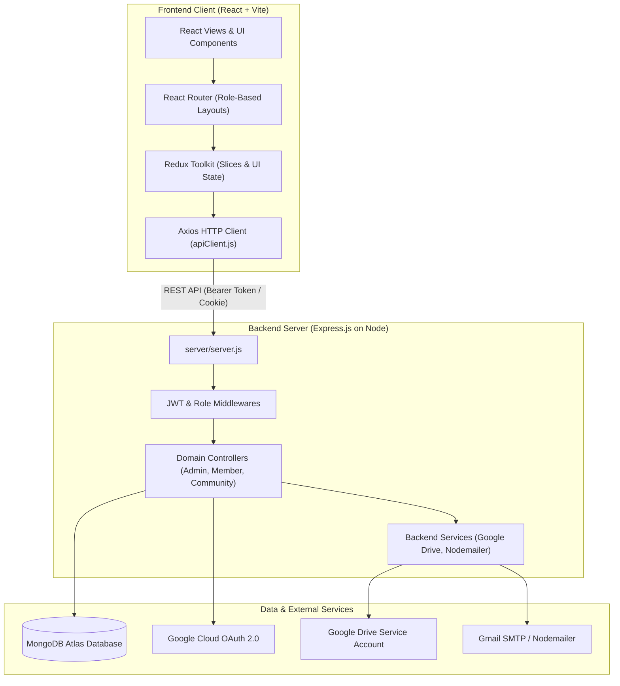

# System Architecture Overview: The Uniques Portal

This document outlines the overarching software architecture, system topologies, runtime data flows, and inter-service relationships of **The Uniques Portal**.

---

## 1. High-Level System Architecture

The Uniques Portal is a full-stack web application designed to manage community cohorts, members, training programs, project showcases, event logistics, leave applications, and coordinator tasks.



---

## 2. Repository Topology

The repository follows a clean monolithic separation of concerns:

| Directory | Role & Responsibilities | Key Files |
| :--- | :--- | :--- |
| [`src/`](file:///run/media/jimfleax/DEV/Projects/The-Uniques-Portal/src) | Single Page Application (SPA) built with React 18, Vite, Material UI (MUI), and Tailwind CSS. | [`App.jsx`](file:///run/media/jimfleax/DEV/Projects/The-Uniques-Portal/src/App.jsx), [`main.jsx`](file:///run/media/jimfleax/DEV/Projects/The-Uniques-Portal/src/main.jsx) |
| [`src/routes/`](file:///run/media/jimfleax/DEV/Projects/The-Uniques-Portal/src/routes) | Route definitions grouped by role (`Admin`, `Management`, `Uniques`, and public landing). | [`MainRoutes.jsx`](file:///run/media/jimfleax/DEV/Projects/The-Uniques-Portal/src/routes/MainRoutes.jsx) |
| [`src/layout/`](file:///run/media/jimfleax/DEV/Projects/The-Uniques-Portal/src/layout) | Layout wrappers providing sidebar navigation, top navigation bars, and authentication wrappers. | [`Management/index.jsx`](file:///run/media/jimfleax/DEV/Projects/The-Uniques-Portal/src/layout/Management/index.jsx), [`Admin/index.jsx`](file:///run/media/jimfleax/DEV/Projects/The-Uniques-Portal/src/layout/Admin/index.jsx) |
| [`src/views/`](file:///run/media/jimfleax/DEV/Projects/The-Uniques-Portal/src/views) | Domain screens for Management dashboards, Uniques360 coordinator/member workspaces, and auth pages. | [`Management/Dashboard/index.jsx`](file:///run/media/jimfleax/DEV/Projects/The-Uniques-Portal/src/views/Management/Dashboard/index.jsx) |
| [`src/services/`](file:///run/media/jimfleax/DEV/Projects/The-Uniques-Portal/src/services) | Centralized API client and endpoint service abstractions. | [`apiClient.js`](file:///run/media/jimfleax/DEV/Projects/The-Uniques-Portal/src/services/apiClient.js), [`authService.js`](file:///run/media/jimfleax/DEV/Projects/The-Uniques-Portal/src/services/authService.js) |
| [`src/redux/`](file:///run/media/jimfleax/DEV/Projects/The-Uniques-Portal/src/redux) | Redux store configuration and state slices for layout customizations. | [`store.js`](file:///run/media/jimfleax/DEV/Projects/The-Uniques-Portal/src/redux/store.js), [`slices/customizationSlice.js`](file:///run/media/jimfleax/DEV/Projects/The-Uniques-Portal/src/redux/slices/customizationSlice.js) |
| [`src/components/`](file:///run/media/jimfleax/DEV/Projects/The-Uniques-Portal/src/components) | Reusable UI atoms and organisms (cards, buttons, headers, tables, loaders, modals). | [`cards/`](file:///run/media/jimfleax/DEV/Projects/The-Uniques-Portal/src/components/cards), [`modals/`](file:///run/media/jimfleax/DEV/Projects/The-Uniques-Portal/src/components/modals) |
| [`server/`](file:///run/media/jimfleax/DEV/Projects/The-Uniques-Portal/server) | Express.js REST API server handling persistence, business rules, file streaming, and authentication. | [`server/server.js`](file:///run/media/jimfleax/DEV/Projects/The-Uniques-Portal/server/server.js) |
| [`server/routes/`](file:///run/media/jimfleax/DEV/Projects/The-Uniques-Portal/server/routes) | Route definitions mapping HTTP verbs and URLs to controller handlers. | [`server/routes/index.js`](file:///run/media/jimfleax/DEV/Projects/The-Uniques-Portal/server/routes/index.js) |
| [`server/controller/`](file:///run/media/jimfleax/DEV/Projects/The-Uniques-Portal/server/controller) | Business logic and request processing handlers. | [`batchController.js`](file:///run/media/jimfleax/DEV/Projects/The-Uniques-Portal/server/controller/Community/batchController.js) |
| [`server/models/`](file:///run/media/jimfleax/DEV/Projects/The-Uniques-Portal/server/models) | Mongoose schemas representing database collections. | [`batchModel.js`](file:///run/media/jimfleax/DEV/Projects/The-Uniques-Portal/server/models/community/batchModel.js) |
| [`server/middlewares/`](file:///run/media/jimfleax/DEV/Projects/The-Uniques-Portal/server/middlewares) | Request pipeline middleware for JWT validation, role checking, error handling, and file uploads. | [`auth.js`](file:///run/media/jimfleax/DEV/Projects/The-Uniques-Portal/server/middlewares/auth.js) |

---

## 3. End-to-End Request & Authentication Flow

### Authentication Lifecycle
1. **Login Request**:
   - The user visits `/login` ([`src/views/Authentication/login/index.jsx`](file:///run/media/jimfleax/DEV/Projects/The-Uniques-Portal/src/views/Authentication/login/index.jsx)) and enters credentials, or triggers Google OAuth.
   - The login form calls `authService.login(email, password)` ([`src/services/authService.js`](file:///run/media/jimfleax/DEV/Projects/The-Uniques-Portal/src/services/authService.js)), which sends a `POST /auth/emaillogin` request.
2. **Server Verification**:
   - `auth.controller.js` ([`server/controller/Authentication/auth.controller.js`](file:///run/media/jimfleax/DEV/Projects/The-Uniques-Portal/server/controller/Authentication/auth.controller.js)) validates password hashes using `bcrypt` and generates a signed JSON Web Token (JWT) using `JWT_SECRET`.
   - The server returns `{ token, user, role }` and optionally sets a session cookie.
3. **Client Token Persistence**:
   - The frontend stores the JWT in browser `localStorage.setItem('token', token)` and updates the Redux/Auth state.
4. **Subsequent API Requests**:
   - Every outgoing request handled by `apiClient` ([`src/services/apiClient.js`](file:///run/media/jimfleax/DEV/Projects/The-Uniques-Portal/src/services/apiClient.js)) passes through an Axios request interceptor.
   - The interceptor automatically appends:
     ```http
     Authorization: Bearer <token>
     token: <token>
     ```
5. **Backend Guarding**:
   - Protected routes pass through `verifyToken` ([`server/middlewares/auth.js`](file:///run/media/jimfleax/DEV/Projects/The-Uniques-Portal/server/middlewares/auth.js)). If valid, the decoded user payload is attached to `req.user`.
   - If unauthorized (401 / expired token), the client response interceptor automatically clears stale sessions and redirects the user safely to `/`.

---

## 4. Single Source of Truth Architecture (Batches Example)

A key architectural pattern implemented in the portal is the **Single Source of Truth** for cohort data:
- In earlier versions, batch names and batch profiles were stored across separate schemas (`Batch` vs `BatchProfile`).
- In the current unified architecture:
  - Both `/api/batches/all` and `/api/batches/profiles` read from the single collection `batchprofiles` via `batchModel.js` ([`server/models/community/batchModel.js`](file:///run/media/jimfleax/DEV/Projects/The-Uniques-Portal/server/models/community/batchModel.js)).
  - When an administrator creates a new batch in [`Management/Batches/index.jsx`](file:///run/media/jimfleax/DEV/Projects/The-Uniques-Portal/src/views/Management/Batches/index.jsx), it immediately reflects across member drop-downs, registration forms, and public showcase filters.

---

## 5. Google Drive Asset Pipeline

Media assets (project PDFs, event images, member headshots) are handled through Google Drive:
- File uploads arrive at the Express backend via `multer` in-memory storage.
- `googleDriveService.js` ([`server/controller/googleDriveService.js`](file:///run/media/jimfleax/DEV/Projects/The-Uniques-Portal/server/controller/googleDriveService.js)) authenticates using the service account credentials defined in `GOOGLE_SERVICE_ACCOUNT`.
- Assets are uploaded directly into designated Drive folders, and public shareable links or file IDs are stored in MongoDB.
- For downloads and previews, the server streams the buffer safely to avoid exposing sensitive API keys to the client.
