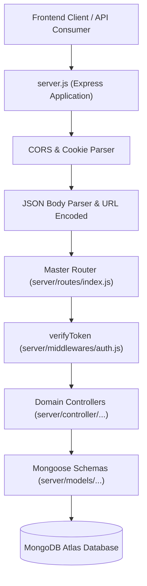
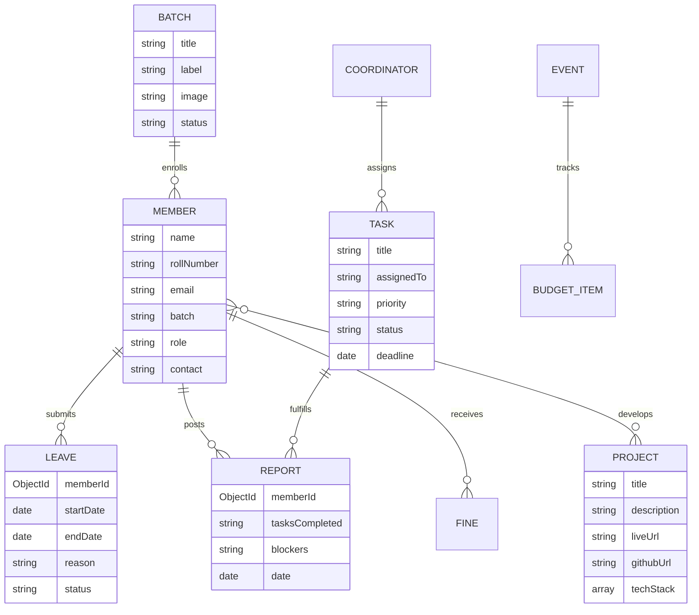

# Backend API and Data Models Reference

This document provides a comprehensive technical overview of the backend server architecture for **The Uniques Portal**, including the Express routing pipeline, middleware authentication, controller logic, and Mongoose database schemas.

---

## 1. Server Architecture and Pipeline

The backend server is an Express.js application configured in [`server/server.js`](file:///run/media/jimfleax/DEV/Projects/The-Uniques-Portal/server/server.js).



---

## 2. Middleware Pipeline

Located in [`server/middlewares/`](file:///run/media/jimfleax/DEV/Projects/The-Uniques-Portal/server/middlewares):

1. **Authentication Guard (`auth.js`)**:
   - `verifyToken`: Extracts the Bearer token from the `Authorization` header, the custom `token` header, or signed cookies. Decodes the JWT via `JWT_SECRET` and attaches user metadata to `req.user`.
   - `checkRole(allowedRoles)`: Higher-order middleware ensuring that only authorized personas (`Admin`, `Coordinator`, or `Member`) can invoke privileged endpoints.
2. **File Uploads (`upload.js`)**:
   - Built on `multer` using memory storage to buffer files for direct streaming to Google Drive via the service account, bypassing local disk storage.
3. **Error Handling (`errorHandler.js`)**:
   - Catches unhandled asynchronous exceptions, logs stack traces, and formats standardized JSON error responses:
     ```json
     {
       "success": false,
       "message": "Human-readable error description",
       "error": "Detailed validation or database exception"
     }
     ```

---

## 3. Database Models & Schema Relationships

Database models reside in [`server/models/`](file:///run/media/jimfleax/DEV/Projects/The-Uniques-Portal/server/models) and connect to MongoDB Atlas through Mongoose.



### Core Model Specifications:

#### 1. Batch Cohort Model: [`server/models/community/batchModel.js`](file:///run/media/jimfleax/DEV/Projects/The-Uniques-Portal/server/models/community/batchModel.js)
- **Collection**: `batchprofiles`
- **Fields**:
  - `title` / `label` (String, required): Canonical cohort identifier (e.g. `"The Uniques 5.0"`).
  - `image` (String): Google Drive asset URL or local asset fallback.
  - `customImage` (Boolean): Flag indicating user-uploaded vs default asset.
  - `status` (String, default: `"active"`): Cohort state (`"active"` vs `"graduated"`).
- **Architectural Note**: Single Source of Truth for both `/api/batches/all` and `/api/batches/profiles`.

#### 2. Member Model: [`server/models/member/memberModel.js`](file:///run/media/jimfleax/DEV/Projects/The-Uniques-Portal/server/models/member/memberModel.js)
- **Collection**: `members`
- **Fields**:
  - `name` (String, required): Student full name.
  - `rollNumber` (String, unique, indexed): University roll number.
  - `email` (String, unique, indexed): SVVIET institutional or personal email.
  - `batch` (String, indexed): Cohort name corresponding to `Batch.title`.
  - `role` (String, enum: `["Member", "Coordinator", "Admin", "Trainer"]`).
  - `fines` (Array of Fine objects): Disciplinary records with payment receipts.

#### 3. Task Model: [`server/models/uniques360/taskModel.js`](file:///run/media/jimfleax/DEV/Projects/The-Uniques-Portal/server/models/uniques360/taskModel.js)
- **Collection**: `tasks`
- **Fields**:
  - `title` (String, required): Task description.
  - `assignedTo` (ObjectId ref `Member`): Recipient student or coordinator.
  - `priority` (String, enum: `["Low", "Medium", "High", "Critical"]`).
  - `status` (String, enum: `["Pending", "In Progress", "Completed", "Blocked"]`).
  - `deadline` (Date): Due date for completion.

#### 4. Report Model: [`server/models/uniques360/reportModel.js`](file:///run/media/jimfleax/DEV/Projects/The-Uniques-Portal/server/models/uniques360/reportModel.js)
- **Collection**: `reports`
- **Fields**:
  - `memberId` (ObjectId ref `Member`): Author of daily submission.
  - `date` (Date, default: `Date.now`): Date of work log.
  - `tasksDone` (String): Accomplishments logged for the cycle.
  - `blockers` (String): Impediments requiring coordinator intervention.

#### 5. Project Model: [`server/models/community/projectModel.js`](file:///run/media/jimfleax/DEV/Projects/The-Uniques-Portal/server/models/community/projectModel.js)
- **Collection**: `projects`
- **Fields**:
  - `title` (String, required): Project headline.
  - `description` (String): Summary of capabilities.
  - `techStack` ([String]): Technologies utilized (e.g. React, Node, Python).
  - `githubUrl` / `liveUrl` (String): External demonstration links.
  - `thumbnail` (String): Google Drive asset identifier.

---

## 4. REST API Endpoint Directory

Mounted at `/api` via [`server/routes/index.js`](file:///run/media/jimfleax/DEV/Projects/The-Uniques-Portal/server/routes/index.js):

| Route Path | HTTP Verb | Access Level | Controller Handler | Purpose |
| :--- | :--- | :--- | :--- | :--- |
| `/auth/emaillogin` | `POST` | Public | [`auth.controller.js`](file:///run/media/jimfleax/DEV/Projects/The-Uniques-Portal/server/controller/Authentication/auth.controller.js) | Verify credentials and sign JWT. |
| `/auth/signup` | `POST` | Public | [`auth.controller.js`](file:///run/media/jimfleax/DEV/Projects/The-Uniques-Portal/server/controller/Authentication/auth.controller.js) | Register new member profile. |
| `/api/batches/all` | `GET` | Public | [`batchController.js`](file:///run/media/jimfleax/DEV/Projects/The-Uniques-Portal/server/controller/Community/batchController.js) | List all canonical cohort names. |
| `/api/batches/profiles` | `GET` | Public | [`batchController.js`](file:///run/media/jimfleax/DEV/Projects/The-Uniques-Portal/server/controller/Community/batchController.js) | Retrieve cohort cards with metadata. |
| `/api/batches/profiles` | `POST` | Private (Admin) | [`batchController.js`](file:///run/media/jimfleax/DEV/Projects/The-Uniques-Portal/server/controller/Community/batchController.js) | Update or add cohort profiles. |
| `/api/admin/members` | `GET` | Private (Admin) | [`memberController.js`](file:///run/media/jimfleax/DEV/Projects/The-Uniques-Portal/server/controller/admin/memberController.js) | Paginated list of registered members. |
| `/api/admin/member/:id` | `PUT` | Private (Admin) | [`memberController.js`](file:///run/media/jimfleax/DEV/Projects/The-Uniques-Portal/server/controller/admin/memberController.js) | Edit student details or assign roles. |
| `/api/events` | `GET` | Public | [`eventController.js`](file:///run/media/jimfleax/DEV/Projects/The-Uniques-Portal/server/controller/events/eventController.js) | Fetch community hackathons & events. |
| `/api/projects` | `GET` | Public | [`projectController.js`](file:///run/media/jimfleax/DEV/Projects/The-Uniques-Portal/server/controller/Community/projectController.js) | Fetch student showcase projects. |
| `/api/uniques360/tasks` | `GET` / `POST` | Private | [`taskController.js`](file:///run/media/jimfleax/DEV/Projects/The-Uniques-Portal/server/controller/uniques360/taskController.js) | Query and dispatch cohort tasks. |
| `/api/uniques360/reports` | `POST` | Private (Member) | [`reportController.js`](file:///run/media/jimfleax/DEV/Projects/The-Uniques-Portal/server/controller/uniques360/reportController.js) | Submit daily progress log. |
