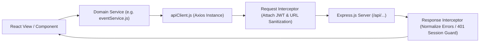

# Services and State Management Architecture

This document provides a comprehensive reference for all client-side network communication services and global application state management in **The Uniques Portal**.

---

## 1. Network Layer Architecture

All HTTP communications are channeled through a centralized Axios client:



### Central API Client: [`src/services/apiClient.js`](file:///run/media/jimfleax/DEV/Projects/The-Uniques-Portal/src/services/apiClient.js)

The client configuration provides:
1. **Dynamic Base URL Resolution**:
   - Reads `import.meta.env.VITE_API_BASE_URL`.
   - Defaults to `http://localhost:5001` during local development.
   - Falls back to `https://theuniquesportal-server.vercel.app` in production environments.
2. **Request Interceptor**:
   - Strips accidental hardcoded domain strings from requested endpoints.
   - Automatically retrieves the active token from `localStorage.getItem('token')` and injects `Authorization: Bearer <token>` and `token: <token>`.
3. **Response & Session Interceptor**:
   - Normalizes server error formats into structured [`ApiError`](file:///run/media/jimfleax/DEV/Projects/The-Uniques-Portal/src/services/apiClient.js) objects (`{ message, status, data }`).
   - Detects 401 unauthenticated statuses or invalid token payloads. If encountered on a protected route, it safely redirects the user to `/` without raising disruptive unhandled exception toasts.

---

## 2. Domain Services Catalog

Every business domain in the portal has a dedicated service module residing in [`src/services/`](file:///run/media/jimfleax/DEV/Projects/The-Uniques-Portal/src/services):

### 1. Authentication Service: [`authService.js`](file:///run/media/jimfleax/DEV/Projects/The-Uniques-Portal/src/services/authService.js)
Manages user credentials, session creation, and password recovery:
- `login(email, password)`: Sends `POST /auth/emaillogin` and returns `{ token, user, role }`.
- `signup(userData)`: Sends `POST /auth/signup` to register new member accounts.
- `logout()`: Clears `localStorage` credentials and unmounts authenticated session contexts.
- `requestPasswordReset(email)`: Sends `POST /auth/forgot-password` to trigger a reset email.
- `resetPassword(token, newPassword)`: Sends `POST /auth/reset-password` with reset token.

### 2. Community & Batches Service: [`communityService.js`](file:///run/media/jimfleax/DEV/Projects/The-Uniques-Portal/src/services/communityService.js)
Enforces the Single Source of Truth for cohort batches and public showcases:
- `getAllBatches()`: Hits `GET /api/batches/all` to retrieve sorted canonical cohort names (`The Uniques 1.0` through `6.0`).
- `getBatchProfiles()`: Hits `GET /api/batches/profiles` to fetch rich cohort metadata (images, bios, dates).
- `saveBatchProfiles(profiles)`: Hits `POST /api/batches/profiles` for bulk cohort administration.
- `getStats()`: Hits `GET /api/stats` to power public impact metrics.

### 3. Events Service: [`eventService.js`](file:///run/media/jimfleax/DEV/Projects/The-Uniques-Portal/src/services/eventService.js)
Handles hackathons, workshops, and cohort events:
- `getEvents(params)`: Retrieves event lists filtered by status (upcoming, ongoing, completed).
- `getEventById(id)`: Fetches complete event agenda, speaker details, and registration logs.
- `createEvent(formData)` / `updateEvent(id, formData)`: Multipart form-data handlers managing image uploads and schedules.
- `deleteEvent(id)`: Removes event records.

### 4. Projects Service: [`projectService.js`](file:///run/media/jimfleax/DEV/Projects/The-Uniques-Portal/src/services/projectService.js)
Manages student showcases, GitHub repositories, and live demo links:
- `getProjects(query)`: Searches and filters project cards by tech stack, batch, or status.
- `createProject(projectData)`: Submits new projects to the database and Drive thumbnail pipeline.
- `updateProject(id, projectData)`: Edits existing project details and member attributions.
- `deleteProject(id)`: Deletes project entry.

### 5. Member & Coordinator Service: [`memberService.js`](file:///run/media/jimfleax/DEV/Projects/The-Uniques-Portal/src/services/memberService.js) & [`coordinatorService.js`](file:///run/media/jimfleax/DEV/Projects/The-Uniques-Portal/src/services/coordinatorService.js)
- `getMembers(filters)`: Supports paginated queries, search by name or roll number, and batch filtering.
- `getMemberById(id)`: Loads full profile history including fine records and leaves.
- `updateMember(id, data)`: Modifies role, contact info, or cohort assignments.
- `getCoordinatorProfile()` / `updateCoordinatorProfile(id, data)`: Manages coordinator assignments.

### 6. Uniques360 Workflow Service: [`uniques360Service.js`](file:///run/media/jimfleax/DEV/Projects/The-Uniques-Portal/src/services/uniques360Service.js)
Powers the daily accountability and reporting engine for students:
- `submitReport(reportData)`: Posts daily work logs, blockers, and completed milestones.
- `getFeedReports(cohortId)`: Fetches peer activity feeds for transparency.
- `getTasks(memberId)` / `updateTaskStatus(taskId, status)`: Coordinates assigned tasks between coordinators and members.

### 7. Leave & Fine Services: [`leaveService.js`](file:///run/media/jimfleax/DEV/Projects/The-Uniques-Portal/src/services/leaveService.js) & [`fineService.js`](file:///run/media/jimfleax/DEV/Projects/The-Uniques-Portal/src/services/fineService.js)
- `applyLeave(leaveData)`: Submits formal leave requests with date ranges and justification.
- `updateLeaveStatus(leaveId, status)`: Allows coordinators to approve or reject requests.
- `getFines(memberId)` / `createFine(fineData)`: Tracks disciplinary or attendance fines.

---

## 3. Global State Management: Redux Toolkit

The application state is centralized in [`src/redux/store.js`](file:///run/media/jimfleax/DEV/Projects/The-Uniques-Portal/src/redux/store.js) using Redux Toolkit.

### Store Architecture
```javascript
// src/redux/store.js
import { configureStore } from '@reduxjs/toolkit';
import userReducer from './slices/userSlice';

export const store = configureStore({
  reducer: {
    user: userReducer,
  },
  middleware: (getDefaultMiddleware) =>
    getDefaultMiddleware({
      serializableCheck: false,
    }),
});
```

### User State Slice: [`src/redux/slices/userSlice.js`](file:///run/media/jimfleax/DEV/Projects/The-Uniques-Portal/src/redux/slices/userSlice.js)
- **State Properties**:
  - `currentUser`: The currently logged-in user profile (`name`, `email`, `role`, `batch`, `avatar`).
  - `isAuthenticated`: Boolean flag indicating active verified session.
  - `token`: Active JWT string mirrored with `localStorage`.
- **Primary Actions**:
  - `loginSuccess(payload)`: Ingests user credentials and token.
  - `logout()`: Cleanses memory state and removes persistent tokens.
  - `updateUserProfile(updates)`: Reactively updates avatar or contact details across the UI navbar and profile views.
