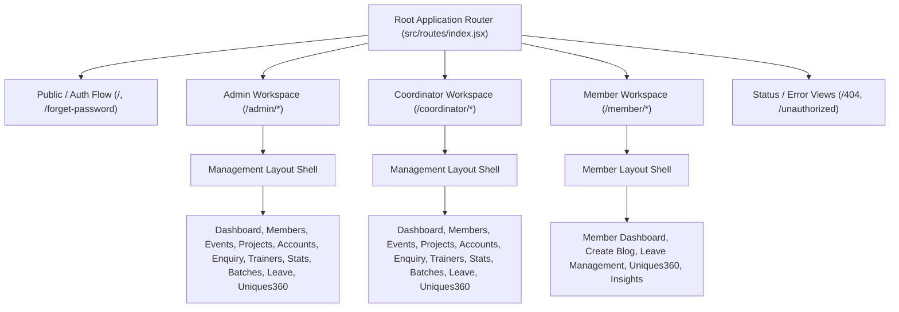

# Comprehensive The Uniques Portal CRUD Audit & Implementation Plan

**Goal:** Reconcile and fix all endpoint discrepancies, complete missing backend CRUD operations (Guest Speakers, Event Members, Fine Receipts, Batches), eliminate broken links/pages across all 22 frontend portal views, and verify every workflow using automated integration tests.

**Architecture:** Horizontal and vertical phased delivery adhering to Test-Driven Development (TDD) and Subagent-Driven Development. Every phase follows a strict Red-Green-Verify cycle:
1. Write isolated, executable failure test reproducing the exact defect or missing CRUD behavior.
2. Implement backend controller logic, route mappings, Mongoose schema validators, and frontend service contracts.
3. Verify tests pass with green assertions and run full portal build checks.
4. Execute atomic git commits.

**Tech Stack:** React 19, React Router v7 Data Router, Vite, Axios, Tailwind CSS, Material UI, Redux Toolkit, Node.js (ESM), Express.js, MongoDB / Mongoose.

---

## 1. Frontend Pages Inventory & Architecture Overview

The Uniques Portal implements a multi-role hierarchy (Admin, Coordinator, Member, Public) driven by React Router v7 Data Router in [`src/routes/index.jsx`](file:///run/media/jimfleax/DEV/Projects/The-Uniques-Portal/src/routes/index.jsx).



### Complete Inventory of All 22 Portal Views

| # | Workspace | Route Path | View Component | File Location | Primary Purpose |
|---|---|---|---|---|---|
| 1 | Auth | `/` (and `/login`) | `Login` | [`src/views/Authentication/login/index.jsx`](file:///run/media/jimfleax/DEV/Projects/The-Uniques-Portal/src/views/Authentication/login/index.jsx) | Portal authentication entry gate |
| 2 | Auth | `/forget-password` | `ForgetPassword` | [`src/views/Authentication/login/ForgetPassword.jsx`](file:///run/media/jimfleax/DEV/Projects/The-Uniques-Portal/src/views/Authentication/login/ForgetPassword.jsx) | Password recovery via OTP / reset link |
| 3 | System | `/forbidden` / `/unauthorized` | `Unauthorized` | [`src/views/Authentication/Unauthorized.jsx`](file:///run/media/jimfleax/DEV/Projects/The-Uniques-Portal/src/views/Authentication/Unauthorized.jsx) | Role RBAC access rejection screen |
| 4 | System | `*` (404) | `NotFound` | [`src/views/NotFound.jsx`](file:///run/media/jimfleax/DEV/Projects/The-Uniques-Portal/src/views/NotFound.jsx) | Catch-all 404 page with navigation |
| 5 | Admin/Coord | `/{role}/dashboard` | `Dashboard` | [`src/views/Management/Dashboard/index.jsx`](file:///run/media/jimfleax/DEV/Projects/The-Uniques-Portal/src/views/Management/Dashboard/index.jsx) | Portal KPIs, recent activities, quick actions |
| 6 | Admin/Coord | `/{role}/members-overview` | `Member` | [`src/views/Management/Members/index.jsx`](file:///run/media/jimfleax/DEV/Projects/The-Uniques-Portal/src/views/Management/Members/index.jsx) | Member directory, status toggle, filtering |
| 7 | Admin/Coord | `/{role}/events-overview` | `Event` | [`src/views/Management/Events/index.jsx`](file:///run/media/jimfleax/DEV/Projects/The-Uniques-Portal/src/views/Management/Events/index.jsx) | Event calendar, status filters, listing |
| 8 | Admin/Coord | `/{role}/events-overview/create` | `EventForm` | [`src/components/event/EventForm.jsx`](file:///run/media/jimfleax/DEV/Projects/The-Uniques-Portal/src/components/event/EventForm.jsx) | Multi-step event creation / edit form |
| 9 | Admin/Coord | `/{role}/events-overview/view/:id` | `EventView` | [`src/views/Management/Events/View.jsx`](file:///run/media/jimfleax/DEV/Projects/The-Uniques-Portal/src/views/Management/Events/View.jsx) | Detailed event view, member roster, guests |
| 10 | Admin/Coord | `/{role}/events-overview/:id/budget` | `EventBudget` | [`src/views/Management/Events/Budget.jsx`](file:///run/media/jimfleax/DEV/Projects/The-Uniques-Portal/src/views/Management/Events/Budget.jsx) | Event financial allocations and expenses |
| 11 | Admin/Coord | `/{role}/projects-overview` | `Projects` | [`src/views/Management/Projects/index.jsx`](file:///run/media/jimfleax/DEV/Projects/The-Uniques-Portal/src/views/Management/Projects/index.jsx) | Project portfolio, tech filters, status |
| 12 | Admin/Coord | `/{role}/projects-overview/create` | `ProjectForm` | [`src/components/project/ProjectForm.jsx`](file:///run/media/jimfleax/DEV/Projects/The-Uniques-Portal/src/components/project/ProjectForm.jsx) | Project submission and attachment upload |
| 13 | Admin/Coord | `/{role}/projects-overview/view/:id` | `ProjectView` | [`src/views/Management/Projects/View.jsx`](file:///run/media/jimfleax/DEV/Projects/The-Uniques-Portal/src/views/Management/Projects/View.jsx) | Project details, team members, links |
| 14 | Admin/Coord | `/{role}/accounts` | `Account` | [`src/views/Management/Accounts/index.jsx`](file:///run/media/jimfleax/DEV/Projects/The-Uniques-Portal/src/views/Management/Accounts/index.jsx) | Disciplinary fines, fee tracking, receipts |
| 15 | Admin/Coord | `/{role}/profile` | `Profile` | [`src/views/Management/Profile/index.jsx`](file:///run/media/jimfleax/DEV/Projects/The-Uniques-Portal/src/views/Management/Profile/index.jsx) | Manager / admin profile editor |
| 16 | Admin/Coord | `/{role}/enquiry` | `Enquiry` | [`src/views/Management/Enquiry/index.jsx`](file:///run/media/jimfleax/DEV/Projects/The-Uniques-Portal/src/views/Management/Enquiry/index.jsx) | Inbound messages, contact resolutions |
| 17 | Admin/Coord | `/{role}/trainers` | `Trainers` | [`src/views/Management/Trainers/index.jsx`](file:///run/media/jimfleax/DEV/Projects/The-Uniques-Portal/src/views/Management/Trainers/index.jsx) | Mentor and trainer roster management |
| 18 | Admin/Coord | `/{role}/stats` | `Stats` | [`src/views/Management/Stats/index.jsx`](file:///run/media/jimfleax/DEV/Projects/The-Uniques-Portal/src/views/Management/Stats/index.jsx) | Community metrics and annual stats |
| 19 | Admin/Coord | `/{role}/batches` | `Batches` | [`src/views/Management/Batches/index.jsx`](file:///run/media/jimfleax/DEV/Projects/The-Uniques-Portal/src/views/Management/Batches/index.jsx) | Student cohort batch configurations |
| 20 | Admin/Coord | `/{role}/leave-management` | `LeaveManagement` | [`src/views/Management/LeaveManagement/index.jsx`](file:///run/media/jimfleax/DEV/Projects/The-Uniques-Portal/src/views/Management/LeaveManagement/index.jsx) | Admin leave approval / rejection workflow |
| 21 | Admin/Coord | `/{role}/uniques360` | `Uniques360` | [`src/views/Uniques360/Coordinator360/Uniques360.jsx`](file:///run/media/jimfleax/DEV/Projects/The-Uniques-Portal/src/views/Uniques360/Coordinator360/Uniques360.jsx) | Coordinator task assignment & monitoring |
| 22 | Member | `/member/dashboard` | `MemberDashboard` | [`src/views/Uniques/Member/index.jsx`](file:///run/media/jimfleax/DEV/Projects/The-Uniques-Portal/src/views/Uniques/Member/index.jsx) | Student profile, portfolio, certifications |

---

## 2. Frontend Services to Backend Endpoints Mapping Matrix

The frontend accesses backend capabilities through dedicated service modules in [`src/services/`](file:///run/media/jimfleax/DEV/Projects/The-Uniques-Portal/src/services/).

| Frontend Service Call | Method | Backend Route | Status | Expected Payload / Params | Controller Action |
|---|---|---|---|---|---|
| `authService.login(creds)` | POST | `/auth/login` | **Working** | `{ email, password }` | `login` in [`authController.js`](file:///run/media/jimfleax/DEV/Projects/The-Uniques-Portal/server/controller/auth/authController.js) |
| `authService.getProfile()` | GET | `/auth/getProfile` / `/api/member/getProfile` | **Working** | None (Bearer JWT) | `getProfile` in [`authController.js`](file:///run/media/jimfleax/DEV/Projects/The-Uniques-Portal/server/controller/auth/authController.js) |
| `eventService.getEvents(params)` | GET | `/api/events` | **Working** | `{ page, limit, status, search }` | `getEvents` in [`eventController.js`](file:///run/media/jimfleax/DEV/Projects/The-Uniques-Portal/server/controller/events/eventController.js) |
| `eventService.createEvent(data)` | POST | `/api/events` | **Working** | Full event schema (embedded banner & guests) | `createEvent` in [`eventController.js`](file:///run/media/jimfleax/DEV/Projects/The-Uniques-Portal/server/controller/events/eventController.js) |
| `eventService.getEventById(id)` | GET | `/api/events/:id` | **Working** | None (ID in param) | `getEventById` in [`eventController.js`](file:///run/media/jimfleax/DEV/Projects/The-Uniques-Portal/server/controller/events/eventController.js) |
| `eventService.updateEvent(id, data)` | PUT | `/api/events/:id` | **Working** | Event update fields | `updateEvent` in [`eventController.js`](file:///run/media/jimfleax/DEV/Projects/The-Uniques-Portal/server/controller/events/eventController.js) |
| `eventService.deleteEvent(id)` | DELETE | `/api/events/:id` | **Working** | None (ID in param) | `deleteEvent` in [`eventController.js`](file:///run/media/jimfleax/DEV/Projects/The-Uniques-Portal/server/controller/events/eventController.js) |
| `eventService.getGuests()` | GET | `/api/guest` | **Divergent** | `{ search, page }` | Backend only exposed `/api/guest/get-all-guests` |
| `eventService.addGuest(data)` | POST | `/api/guest` | **Divergent** | `{ name, designation, topic, photo }` | Backend only exposed `/api/guest/add-guest` |
| `eventService.updateGuest(id, data)`| PUT | `/api/guest/:id` | **Missing in Backend** | `{ name, designation, topic, photo }` | **No update controller exists in guestRoute!** |
| `eventService.deleteGuest(id)` | DELETE | `/api/guest/:id` | **Missing in Backend** | None | **No delete controller exists in guestRoute!** |
| `eventService.removeEventMember(eId, mId)` | DELETE | `/api/events/:id/members/:memberId` | **Missing in Backend** | None | Backend expects team params or PATCH with body |
| `fineService.getFineStatistics()` | GET | `/api/admin/fine/fines/statistics` | **Working** | None | `getFineStats` in [`fineController.js`](file:///run/media/jimfleax/DEV/Projects/The-Uniques-Portal/server/controller/admin/fineController.js) |
| `fineService.getFineMembers(p)` | GET | `/api/admin/fine/fines/members` | **Working** | `{ page, limit, search }` | `getAllMembersWithFines` in [`fineController.js`](file:///run/media/jimfleax/DEV/Projects/The-Uniques-Portal/server/controller/admin/fineController.js) |
| `fineService.getMyFines()` | GET | `/api/fine` | **Divergent** | None (Bearer JWT) | Backend only exposed `/api/fine/profile/fines` |
| `fineService.updateFineStatus(...)`| PATCH | `/api/admin/fine/members/:mId/fines/:fId` | **Buggy** | `{ status, proofOfPaymentId }` | Loses File URL when setting only `{ _id }` |
| `communityService.getBatches()` | GET | `/api/batches` | **Divergent** | None | Backend only exposed `/api/batches/all` |
| `communityService.createBatch(d)` | POST | `/api/batches` | **Divergent** | `{ name, year, description }` | Backend only exposed `/api/batches/add` |
| `communityService.applyCampusAmbassador(d)` | POST | `/api/apply-campus-ambassador` | **Divergent** | Form data | Backend only exposed `/api/campus-ambassador/apply` |
| `leaveService.getAllLeaves(p)` | GET | `/api/leave/all` | **Working** | `{ status, page }` | `getAllLeaves` in [`leaveController.js`](file:///run/media/jimfleax/DEV/Projects/The-Uniques-Portal/server/controller/leave/leaveController.js) |
| `leaveService.approveLeave(id, r)` | PUT | `/api/leave/:id/approve` | **Working** | `{ remarks }` | `approveLeave` in [`leaveController.js`](file:///run/media/jimfleax/DEV/Projects/The-Uniques-Portal/server/controller/leave/leaveController.js) |
| `leaveService.rejectLeave(id, r)` | PUT | `/api/leave/:id/reject` | **Working** | `{ remarks }` | `rejectLeave` in [`leaveController.js`](file:///run/media/jimfleax/DEV/Projects/The-Uniques-Portal/server/controller/leave/leaveController.js) |
| `trainerService.getAllTrainers()` | GET | `/api/admin/trainers/all-trainers` | **Working** | None | `getAllTrainers` in [`trainerController.js`](file:///run/media/jimfleax/DEV/Projects/The-Uniques-Portal/server/controller/trainers/trainerController.js) |
| `uniques360Service.createTask(d)` | POST | `/api/uniques360/tasks` | **Working** | `{ title, description, assignedTo }` | `createTask` in [`taskController.js`](file:///run/media/jimfleax/DEV/Projects/The-Uniques-Portal/server/controller/uniques360/taskController.js) |

---

## 3. Flagged Issues & Root-Cause Remediation

### Issue 1: Guest Speaker Management Endpoints Mismatch & Incomplete Backend CRUD
- **Symptoms:** Attempting to update or delete guest speakers from [`src/services/eventService.js`](file:///run/media/jimfleax/DEV/Projects/The-Uniques-Portal/src/services/eventService.js) returns `404 Not Found`. `getGuests()` and `addGuest()` fail unless calling `/get-all-guests` or `/add-guest`.
- **Root Cause:** In [`server/routes/guest/guestRoute.js`](file:///run/media/jimfleax/DEV/Projects/The-Uniques-Portal/server/routes/guest/guestRoute.js), only `POST /add-guest`, `POST /bulkUpload`, `GET /get-all-guests`, and `GET /get-guest/:id` were defined. There were **no** `PUT` or `DELETE` route declarations, and no `updateGuest` or `deleteGuest` controllers in [`server/controller/guest/guestController.js`](file:///run/media/jimfleax/DEV/Projects/The-Uniques-Portal/server/controller/guest/guestController.js).
- **Remediation:**
  1. In `guestController.js`: Implement `updateGuest` (finding guest by ID and updating fields) and `deleteGuest` (deleting guest document).
  2. In `guestRoute.js`: Add standard REST aliases:
     - `router.get('/', getAllGuests)`
     - `router.post('/', addGuest)`
     - `router.get('/:id', getGuestById)`
     - `router.put('/:id', updateGuest)` and `router.put('/update-guest/:id', updateGuest)`
     - `router.delete('/:id', deleteGuest)` and `router.delete('/delete-guest/:id', deleteGuest)`

### Issue 2: Event Member Removal Route Discrepancy
- **Symptoms:** Calling `eventService.removeEventMember(eventId, memberId)` fails with `404 Cannot DELETE /api/events/:id/members/:memberId`.
- **Root Cause:** Backend [`server/routes/events/eventRoutes.js`](file:///run/media/jimfleax/DEV/Projects/The-Uniques-Portal/server/routes/events/eventRoutes.js) defined `DELETE /:id/members/team/:teamType/members` and `PATCH /:id/members/remove`, but lacked the canonical REST route `DELETE /:id/members/:memberId`.
- **Remediation:**
  - Add `router.delete('/:id/members/:memberId', removeEventMemberREST)` to [`eventRoutes.js`](file:///run/media/jimfleax/DEV/Projects/The-Uniques-Portal/server/routes/events/eventRoutes.js). The controller pulls `memberId` from `req.params.memberId` and removes the member across all team arrays (`lead`, `core`, `volunteer`, `attendee`).

### Issue 3: Fine Payment Proof URL Loss & Receipt Preview Failure
- **Symptoms:** Clicking "View Receipt" in [`TransactionTable.jsx`](file:///run/media/jimfleax/DEV/Projects/The-Uniques-Portal/src/views/Management/Accounts/components/TransactionTable.jsx) alerts `"Cannot open receipt: File not found"`.
- **Root Cause:** In [`fineController.js`](file:///run/media/jimfleax/DEV/Projects/The-Uniques-Portal/server/controller/admin/fineController.js) line 212, when `proofOfPaymentId` is provided, the controller executed:
  `member.fines[fineIndex].proofOfPayment = { _id: proofOfPaymentId };`
  This discarded `fileUrl`, `url`, `webViewLink`, and `name`. When [`TransactionTable.jsx`](file:///run/media/jimfleax/DEV/Projects/The-Uniques-Portal/src/views/Management/Accounts/components/TransactionTable.jsx) checks `fine.proofOfPayment.fileUrl`, it is undefined!
- **Remediation:**
  1. In `fineController.js`: Import `File` model from [`server/models/file/fileModel.js`](file:///run/media/jimfleax/DEV/Projects/The-Uniques-Portal/server/models/file/fileModel.js). Look up `await File.findById(proofOfPaymentId)` and populate:
     ```javascript
     member.fines[fineIndex].proofOfPayment = {
       _id: fileDoc._id,
       fileId: fileDoc.fileId,
       fileUrl: fileDoc.webViewLink || fileDoc.webContentLink || fileDoc.url,
       url: fileDoc.webViewLink || fileDoc.webContentLink || fileDoc.url,
       name: fileDoc.name,
     };
     ```
  2. In `TransactionTable.jsx`: Ensure `handleOpenReceipt` falls back gracefully to `fileUrl.url || fileUrl.fileUrl || fileUrl.webViewLink || fileUrl.fileId`.

### Issue 4: Fine Service Member Fines 404
- **Symptoms:** `fineService.getMyFines()` returns `404 Not Found`.
- **Root Cause:** In `server/routes/admin/fineRoute.js`, only `/profile/fines` and `/profile/fines/pending` were defined. `GET /api/fine` was unhandled.
- **Remediation:** In [`server/routes/admin/fineRoute.js`](file:///run/media/jimfleax/DEV/Projects/The-Uniques-Portal/server/routes/admin/fineRoute.js), add `router.get('/', fineMemberController.getMemberFines)` and also update [`fineService.js`](file:///run/media/jimfleax/DEV/Projects/The-Uniques-Portal/src/services/fineService.js) to call `/api/fine/profile/fines`.

### Issue 5: Community & Batches REST Route Alignment
- **Symptoms:** `communityService.getBatches()` calls `/api/batches`, returning 404 because backend expects `/api/batches/all`.
- **Root Cause:** Discrepancy between RESTful naming in services and legacy `/all` / `/add` route definitions in [`server/routes/batches/batchesRoute.js`](file:///run/media/jimfleax/DEV/Projects/The-Uniques-Portal/server/routes/batches/batchesRoute.js).
- **Remediation:** Support both paths in `batchesRoute.js`:
  - `router.get('/', getAllBatches)` and `router.get('/all', getAllBatches)`
  - `router.post('/', addBatch)` and `router.post('/add', addBatch)`
  - Mount `POST /api/campus-ambassador/apply` alias for `/api/apply-campus-ambassador`.

### Issue 6: Leave Management Native Fetch Token Omission
- **Symptoms:** Navigating to Leave Management as Admin or Member intermittently throws `401 Unauthorized` or displays empty states if cookies are not set across domains.
- **Root Cause:** Both [`src/views/Management/LeaveManagement/index.jsx`](file:///run/media/jimfleax/DEV/Projects/The-Uniques-Portal/src/views/Management/LeaveManagement/index.jsx) and [`src/views/Uniques/Member/LeaveManagement/index.jsx`](file:///run/media/jimfleax/DEV/Projects/The-Uniques-Portal/src/views/Uniques/Member/LeaveManagement/index.jsx) invoked native `fetch()` with `credentials: 'include'` rather than passing the `Authorization: Bearer <token>` header from `localStorage`.
- **Remediation:** Replace all raw `fetch` calls with [`leaveService.js`](file:///run/media/jimfleax/DEV/Projects/The-Uniques-Portal/src/services/leaveService.js), ensuring automatic token injection and error handling via [`apiClient.js`](file:///run/media/jimfleax/DEV/Projects/The-Uniques-Portal/src/services/apiClient.js).

---

## 4. Catalog of Uncalled Backend Endpoints (~100 Routes)

Backend routing contains ~100 endpoints with no direct frontend invocation from the portal. Audit analysis reveals three legitimate categories:

1. **One-Time Schema & Drive Migration Scripts (21 Routes):**
   - Routes under `/api/admin/migration/*` (e.g. `/api/admin/migration/migrate-profile-pics`, `/api/admin/migration/fix-phone-indices`, `/api/admin/migration/unify-drive-storage`).
   - Purpose: Admin maintenance and data transformation pipelines between schema revisions.
2. **Public Landing Website Integration (35 Routes):**
   - Routes under `/api/community/*`, `/api/public/members/*`, `/api/contact/`, `/api/campus-ambassador/apply`.
   - Purpose: Consumed by the public-facing organization website (`theuniques.in`) to show public projects, team showcase, and collect public inquiries.
3. **Internal Operational Probes & Fallbacks (44 Routes):**
   - `/health`, `/api/health`: Orchestration health checks for container runtimes.
   - Dual-mount endpoints: `/api/upload/*` alongside root `/upload/*` for backward compatibility with legacy scripts.
   - Administrative CSV bulk upload tools: `/api/guest/bulkUpload`.

---

## 5. Phased Implementation Plan

### Phase 1: Guest Speakers Complete CRUD Implementation
**Goal:** Deliver full `GET`, `POST`, `PUT`, `DELETE` operations for guests with schema validation and REST route compatibility.

#### Task 1.1: Write failing integration test for Guest CRUD
- **Files:**
  - Create: `server/scratch/test_guest_crud.cjs`
- **Step 1:** Write test asserting `GET /api/guest`, `POST /api/guest`, `PUT /api/guest/:id`, and `DELETE /api/guest/:id`.
- **Step 2:** Run `node server/scratch/test_guest_crud.cjs` and verify it fails with 404 on `PUT` and `DELETE`.

#### Task 1.2: Implement `updateGuest` and `deleteGuest` in controller
- **Files:**
  - Modify: [`server/controller/guest/guestController.js`](file:///run/media/jimfleax/DEV/Projects/The-Uniques-Portal/server/controller/guest/guestController.js)
- **Step 1:** Add `updateGuest` and `deleteGuest` handlers supporting ObjectId validation and returning standard JSON `{ success: true, message, data }`.

#### Task 1.3: Update Guest Routes with REST aliases
- **Files:**
  - Modify: [`server/routes/guest/guestRoute.js`](file:///run/media/jimfleax/DEV/Projects/The-Uniques-Portal/server/routes/guest/guestRoute.js)
- **Step 1:** Add `router.get('/')`, `router.post('/')`, `router.get('/:id')`, `router.put('/:id')`, `router.delete('/:id')`.
- **Step 2:** Re-run `node server/scratch/test_guest_crud.cjs` to verify PASS.

---

### Phase 2: Event Member Assignment & Lifecycle REST Alignment
**Goal:** Enable direct member removal and additions via standard REST patterns in [`eventService.js`](file:///run/media/jimfleax/DEV/Projects/The-Uniques-Portal/src/services/eventService.js).

#### Task 2.1: Write failing test for Event Member REST endpoints
- **Files:**
  - Create: `server/scratch/test_event_members.cjs`
- **Step 1:** Assert `DELETE /api/events/:id/members/:memberId` removes member from event.
- **Step 2:** Run test to verify failure.

#### Task 2.2: Add REST endpoint in Event Controller & Route
- **Files:**
  - Modify: [`server/controller/events/eventController.js`](file:///run/media/jimfleax/DEV/Projects/The-Uniques-Portal/server/controller/events/eventController.js)
  - Modify: [`server/routes/events/eventRoutes.js`](file:///run/media/jimfleax/DEV/Projects/The-Uniques-Portal/server/routes/events/eventRoutes.js)
- **Step 1:** Support `DELETE /:id/members/:memberId` removing member from `eventMembers` array.
- **Step 2:** Re-run `node server/scratch/test_event_members.cjs` to verify PASS.

---

### Phase 3: Fine Receipt Storage Loss & Preview Fixes
**Goal:** Preserve payment receipt metadata upon fine settlement and enable previewing receipts in the UI.

#### Task 3.1: Write failing test for Fine Receipt Storage
- **Files:**
  - Create: `server/scratch/test_fine_receipt_population.cjs`
- **Step 1:** Create mock file in `File` model, call `PATCH /api/admin/fine/members/:memberId/fines/:fineId` with `proofOfPaymentId`, assert saved fine has populated `fileUrl` and `url`.
- **Step 2:** Run test to verify it currently fails (lacking `fileUrl`).

#### Task 3.2: Update Fine Controller to populate File metadata
- **Files:**
  - Modify: [`server/controller/admin/fineController.js`](file:///run/media/jimfleax/DEV/Projects/The-Uniques-Portal/server/controller/admin/fineController.js)
- **Step 1:** Query `File.findById(proofOfPaymentId)` and embed full object with `fileUrl` and `url`.
- **Step 2:** Re-run test to verify PASS.

#### Task 3.3: Enhance TransactionTable Receipt Preview Handler
- **Files:**
  - Modify: [`src/views/Management/Accounts/components/TransactionTable.jsx`](file:///run/media/jimfleax/DEV/Projects/The-Uniques-Portal/src/views/Management/Accounts/components/TransactionTable.jsx)
- **Step 1:** Support `proofOfPayment.url || proofOfPayment.fileUrl || proofOfPayment.webViewLink || proofOfPayment._id`.

---

### Phase 4: Community, Batches & Fine Service Route Alignment
**Goal:** Align [`fineService.js`](file:///run/media/jimfleax/DEV/Projects/The-Uniques-Portal/src/services/fineService.js), [`communityService.js`](file:///run/media/jimfleax/DEV/Projects/The-Uniques-Portal/src/services/communityService.js), and backend routes.

#### Task 4.1: Add Batches & Fine REST routes
- **Files:**
  - Modify: [`server/routes/batches/batchesRoute.js`](file:///run/media/jimfleax/DEV/Projects/The-Uniques-Portal/server/routes/batches/batchesRoute.js)
  - Modify: [`server/routes/admin/fineRoute.js`](file:///run/media/jimfleax/DEV/Projects/The-Uniques-Portal/server/routes/admin/fineRoute.js)
- **Step 1:** Support `GET /` and `POST /` on `batchesRoute.js`. Support `GET /` on `fineRoute.js`.
- **Step 2:** Verify with integration script `server/scratch/test_service_alignments.cjs`.

---

### Phase 5: Leave Management Service & Token Standardization
**Goal:** Eliminate native `fetch` from Leave Management screens to guarantee authenticated requests.

#### Task 5.1: Refactor Management Leave View
- **Files:**
  - Modify: [`src/views/Management/LeaveManagement/index.jsx`](file:///run/media/jimfleax/DEV/Projects/The-Uniques-Portal/src/views/Management/LeaveManagement/index.jsx)
- **Step 1:** Import `leaveService` and replace all raw `fetch` calls with `leaveService.getAllLeaves()`, `leaveService.approveLeave()`, `leaveService.rejectLeave()`.

#### Task 5.2: Refactor Member Leave View
- **Files:**
  - Modify: [`src/views/Uniques/Member/LeaveManagement/index.jsx`](file:///run/media/jimfleax/DEV/Projects/The-Uniques-Portal/src/views/Uniques/Member/LeaveManagement/index.jsx)
- **Step 1:** Replace raw `fetch` calls with `leaveService.getMyLeaves()`, `leaveService.submitLeaveRequest()`, `leaveService.deleteLeaveRequest()`.

---

### Phase 6: Comprehensive End-to-End Verification
**Goal:** Validate all 22 views and CRUD operations against the live database and run frontend production build checks.

#### Task 6.1: Run End-to-End CRUD Verification Suite
- **Files:**
  - Create: `server/scratch/verify_all_portal_crud.cjs`
- **Step 1:** Execute end-to-end tests covering Auth, Events, Guests, Members, Projects, Fines, Leaves, Batches, and Uniques360.
- **Expected Output:** 100% passing tests with zero 404s or validation failures.

#### Task 6.2: Frontend Production Build & Bundle Check
- **Command:** `npm run build`
- **Expected Output:** Clean Vite build with zero JSX, route, or module resolution errors.

---

## 6. Execution Options

Please review the plan above. Once approved, we can proceed with execution using one of two options:

1. **Option 1 (Recommended): Autonomous Phased Delivery (`/subagent-driven-development`)**
   - Execute Phases 1 through 6 sequentially with isolated subagents and automated test verification after every step.
2. **Option 2: Interactive Step-by-Step Delivery**
   - Pause for your confirmation after each individual phase before continuing to the next.
